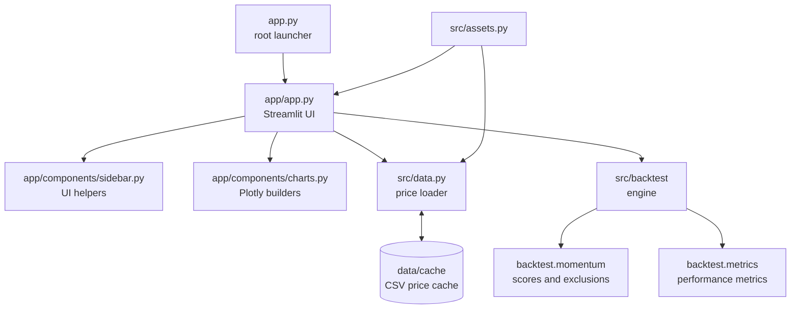

# Architecture

This project is a Python backtesting library with a Streamlit presentation
layer. The core engine is deterministic for a given price table; network
access is isolated in the data loader.

## System overview



## Package layout

- `app.py` is the deployment-friendly root launcher.
- `app/` contains Streamlit-specific orchestration and reusable UI
  components. `charts.py` builds Plotly figures without owning application
  state; `sidebar.py` contains shared request and caching helpers.
- `src/assets.py` defines built-in assets and ticker parsing.
- `src/data.py` downloads, caches, tidies, and converts price data.
- `src/backtest/` contains the strategy interface, momentum
  scoring, simulation engine, and metrics.
- `src/periods.py` provides period selection and availability
  helpers.
- `tests/` contains pure unit tests and Streamlit `AppTest` tests.

## Backtest data flow

1. The UI collects tickers and settings.
2. `load_prices` obtains adjusted daily closes and forward-fills missing
   observations after sorting the index.
3. `momentum_table` creates month-end signals. A signal at date `d` only uses
   prices available through `d`.
4. The engine selects the top `N` eligible assets at each rebalance date.
   The position is set at that close and earns returns from the next trading
   day.
5. Between rebalances, holdings drift according to their price changes.
6. `compute_metrics` derives return and risk statistics from the resulting
   equity curve.
7. The UI adds benchmarks and renders the comparison, drawdown, and
   composition charts.

## Momentum and outlier mathematics

For month-end prices `P`:

```text
momentum(t) = P(t - skip) / P(t - lookback) - 1
```

The volatility-adjusted score divides that return by the standard deviation
of daily returns over the same lookback window:

```text
adjusted_score(t) = momentum(t) / std(daily_returns(window))
```

Zero volatility produces a score of zero. Outlier exclusion uses the modified
z-score:

```text
z = 0.6745 * (score - median(score)) / MAD(score)
MAD = median(abs(score - median(score)))
```

Only scores above the configured threshold are excluded. Exclusion is
disabled when fewer than four assets are ranked, when the MAD is zero, or
when exclusion would leave fewer than `N` assets.

## Portfolio weights and drift

At each rebalance, selected assets receive equal target weights:

```text
target_weight = 1 / number_of_selected_assets
```

For each day after the rebalance, the value contribution is:

```text
value = target_weight * price_today / price_at_rebalance
```

No trades occur between rebalance dates. The engine uses the previous known
signal when a custom backtest start falls between signal dates, so prices
before the requested start can inform the first position without introducing
future information.

## Caching

The data layer stores one CSV per ticker under `data/cache/`. Cached files
younger than 12 hours are reused. A damaged cache row is rejected and the
ticker is downloaded again; writes use a temporary file followed by an atomic
replace.

The Streamlit price-loading wrapper uses `st.cache_data` with a 12-hour TTL.
Tests replace `data._load` and `data._quote_currency`, so the test suite never
needs network access.

## Multi-currency conversion

Each ticker has a quote currency. Built-in assets are treated as USD; custom
ticker currencies are read from a cached metadata file or Yahoo Finance.
Unknown currencies are treated as USD and reported to the UI.

For a quote currency `q` and display currency `c`, the loader applies:

```text
price_in_c = price_in_q * rate(c per USD) / rate(q per USD)
```

Rates are aligned to the price index with forward-fill only. This avoids
using a later exchange-rate observation to convert an earlier price. London
pence quotes are scaled to pounds before conversion.
